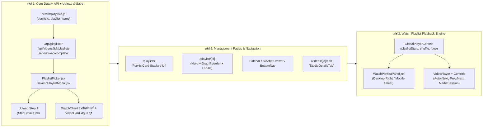

# TubeLock Playlist System — Engineering & UX/UI Specification (v1.0)

> **สถานะเอกสาร:** Approved Blueprint สำหรับส่งต่อให้ Dev Agent พัฒนาตามแผนอย่างเคร่งครัด  
> **โปรเจกต์:** `next-tubelock` (Next.js 16.3.5 App Router + React 19 + Tailwind CSS v4 + Neon Postgres Serverless)  
> **วันที่จัดทำ:** 19 พฤศจิกายน 2026  
> **ข้อกำหนดหลักที่ผู้ใช้งานยืนยันแล้ว:**
> 1. **สิทธิ์การมองเห็นเริ่มต้น:** `private` (ส่วนตัว — เจ้าของเห็นคนเดียว และปรับเป็น `unlisted` หรือ `public` ได้ภายหลัง)
> 2. **ตำแหน่งการเพิ่มคลิปใหม่:** **ต่อท้ายรายการเสมอ** (`position = MAX(position) + 1`)
> 3. **System Playlists ตั้งแต่เฟส 1:** มี **`ดูภายหลัง` (`watch_later` / alias `WL`)** และ **`วิดีโอที่ชอบ` (`liked` / alias `LL`)** ตั้งแต่เฟส 1 พร้อมผูกปุ่มไลก์และปุ่มบันทึกของจริง
> 4. **เฟส 4 (อัปโหลดหลายไฟล์ + เรียงตามชื่อไฟล์อัตโนมัติ):** **ยังไม่ทำในรอบนี้** แต่ Schema และ API รองรับไว้แล้ว

---

## 1. กฎเหล็กสำหรับ Dev Agent (Strict Guardrails — ห้ามทำนอกแผน)

Dev Agent ที่นำเอกสารนี้ไปพัฒนาต่อ **ต้องปฏิบัติตามข้อห้ามและกติกาด้านล่างอย่างเคร่งครัด**:

1. **ห้ามติดตั้ง npm package ใหม่ทุกชนิด** (เช่น ห้ามติดตั้ง `@dnd-kit`, `react-beautiful-dnd`, `sortablejs`, `radix-dialog` ฯลฯ) ให้ใช้เฉพาะ dependencies ที่มีอยู่แล้วใน `package.json` (`lucide-react`, `framer-motion`, Tailwind CSS v4, React 19, Native HTML5 Drag-and-Drop และปุ่มเลื่อนขึ้น/ลง)
2. **ห้ามทำลายสถาปัตยกรรม Global Singleton `#movie_player`:**
   - ในหน้า `/watch/[id]` ห้ามเปลี่ยน `<VideoPlayer>` ไป mount แยกใหม่ และห้ามใช้ `<Link>` ที่บังคับ unmount `WatchClient` เมื่อสลับคลิปภายในเพลย์ลิสต์
   - การสลับคลิปในเพลย์ลิสต์บนหน้า `/watch/[id]` **ต้องเรียกผ่าน `handleSelectVideo` ใน `src/context/GlobalPlayerContext.jsx`** เพื่อคง `<video>` และ `#movie_player` เดิมไว้ 100% (ป้องกันเสียงตัดและอาการกระตุกบน PWA)
3. **ห้ามละเมิดงบ \$0 Free Tier (Neon Postgres & Vercel Hobby):**
   - ทุก API route ของระบบ Playlist **ต้องใช้ `getCachedServerSession()` จาก `src/lib/access.js`** (อ่าน `session?.id`) ห้ามเขียนฟังก์ชัน query `user_sessions` ซ้ำใหม่เด็ดขาด
   - ห้าม query แบบ N+1 (เช่น loop ยิง SQL ทีละ playlist หรือ loop `UPDATE position` ทีละแถวตอน reorder) — ต้องใช้ `LATERAL` / `LEFT JOIN` / `UPDATE ... FROM unnest(...)` ใน query เดียว
   - ห้ามเพิ่มการยิง API polling ถี่ ๆ หรือยิง `/api/playlists` บนหน้า `/` (Home feed) โดยไม่จำเป็น (ให้โหลดแบบ lazy เฉพาะตอนเปิด `PlaylistPicker` / `SaveToPlaylistModal` หรือเข้าหน้า `/playlists`, `/playlist/[id]`, `/watch/[id]?list=...`)
4. **ห้ามหลุดภาพปก 18+ (Strict 18+ Poster Protection):**
   - ทุก API ที่ส่งข้อมูลวิดีโอในเพลย์ลิสต์หรือภาพปกเพลย์ลิสต์ **ต้องผ่าน `protectVideoPoster()`** (`src/lib/videoUtils.js`) เสมอ
   - ภาพปกของเพลย์ลิสต์ (`preview_thumbnail`) **ต้องเลือกจากคลิปแรกที่ไม่ใช่ 18+ (`content_rating != '18+'`) ก่อนเสมอ** หากทั้งเพลย์ลิสต์มีแต่คลิป 18+ ให้ส่ง `preview_is_mature: true` และ `preview_thumbnail: RESTRICTED_POSTER` (`/images/restricted-poster.svg`) เพื่อแสดงเลเยอร์ล็อก 18+ ห้ามส่งรูปปก 18+ ดิบออกไปในที่สาธารณะหรือก่อนผู้ใช้เปิดสิทธิ์
5. **ห้ามเปลี่ยนโทนสี/ดีไซน์ออกนอกระบบ TubeLock:**
   - ต้องรองรับทั้ง **Light Mode** (`#FBF9F5`, `#FFFFFF`, `#F4F0E8`, `#EFECE6`, `#212529`) และ **Dark Mode** (`#0F0F0F`, `#181818`, `#222222`, `white/10`, `#F1F1F1`) โดยใช้สีส้มแบรนด์ `#FF7A00` เป็น Primary Accent
   - **ห้ามแก้ UI หน้าจบคลิปฝั่ง PC Desktop (`!isMobileView`)** ยกเว้นส่วนรองรับคิวเพลย์ลิสต์ที่ระบุไว้ในเฟส 3
6. **ห้ามแตะ `.env.local`** และ **ห้ามทำเกินขอบเขตของเฟสที่ได้รับมอบหมาย** (ทำทีละเฟสให้ผ่าน `npx eslint` และ `npm run build` ด้วย `0 errors` ก่อนขึ้นเฟสถัดไป)

---

## 2. ภาพรวมสถาปัตยกรรมและแผนแบ่งเฟส (Architecture & Phased Rollout)



---

## 3. โครงสร้างฐานข้อมูล (Database Schema — Neon Postgres)

### 3.1 ไฟล์สร้างและจัดการ Schema: `src/lib/playlists.js`

ใช้รูปแบบ idempotent เดียวกับ [src/lib/videoVersions.js](file:///f:/next-tubelock/src/lib/videoVersions.js) (มี flag `let playlistSchemaChecked = false` ระดับโมดูล และเรียกซ้ำได้ใน [src/lib/initDb.js](file:///f:/next-tubelock/src/lib/initDb.js)):

```sql
-- 1. ตารางหลักเก็บข้อมูลเพลย์ลิสต์
CREATE TABLE IF NOT EXISTS playlists (
  id                    SERIAL PRIMARY KEY,
  user_id               INT NOT NULL REFERENCES users(id) ON DELETE CASCADE,
  title                 VARCHAR(120) NOT NULL,
  description           TEXT NOT NULL DEFAULT '',
  visibility            VARCHAR(20) NOT NULL DEFAULT 'private'
                        CHECK (visibility IN ('private', 'unlisted', 'public')),
  kind                  VARCHAR(20) NOT NULL DEFAULT 'normal'
                        CHECK (kind IN ('normal', 'watch_later', 'liked')),
  custom_thumbnail_url  TEXT NOT NULL DEFAULT '',
  created_at            TIMESTAMPTZ NOT NULL DEFAULT NOW(),
  updated_at            TIMESTAMPTZ NOT NULL DEFAULT NOW()
);

-- ป้องกันการสร้าง System Playlist ซ้ำซ้อนต่อผู้ใช้ 1 คน (รองรับ concurrent requests)
CREATE UNIQUE INDEX IF NOT EXISTS uq_playlists_user_system_kind
  ON playlists (user_id, kind)
  WHERE kind IN ('watch_later', 'liked');

-- เร่งความเร็วการดึงรายการเพลย์ลิสต์ของผู้ใช้ตามเวลาอัปเดตล่าสุด
CREATE INDEX IF NOT EXISTS idx_playlists_user_updated
  ON playlists (user_id, updated_at DESC, id DESC);

-- 2. ตารางความสัมพันธ์ระหว่างเพลย์ลิสต์กับวิดีโอ (Many-to-Many + ลำดับ)
CREATE TABLE IF NOT EXISTS playlist_items (
  id           SERIAL PRIMARY KEY,
  playlist_id  INT NOT NULL REFERENCES playlists(id) ON DELETE CASCADE,
  video_id     INT NOT NULL REFERENCES videos(id) ON DELETE CASCADE,
  position     INT NOT NULL DEFAULT 0,
  added_at     TIMESTAMPTZ NOT NULL DEFAULT NOW(),
  UNIQUE (playlist_id, video_id)
);

-- เร่งความเร็วการอ่านรายการในเพลย์ลิสต์ตามลำดับ (รองรับเฟส 3 และหน้า /playlist/[id])
CREATE INDEX IF NOT EXISTS idx_playlist_items_order
  ON playlist_items (playlist_id, position ASC, added_at ASC);

-- เร่งความเร็วการเช็กว่าวิดีโอ 1 ตัวอยู่ในเพลย์ลิสต์ไหนบ้าง (GET /api/videos/[id]/playlists)
CREATE INDEX IF NOT EXISTS idx_playlist_items_video
  ON playlist_items (video_id);
```

### 3.2 กติกา System Playlists และ Alias

| `kind` | URL Alias (`list` / `/playlist/[id]`) | ชื่อแสดงผลถาวร | `visibility` ถาวร | ลบ / เปลี่ยนชื่อ / เปลี่ยน visibility ได้ไหม? |
| :--- | :--- | :--- | :--- | :--- |
| `watch_later` | `WL` (รองรับ `wl`, `watch_later`) | `ดูภายหลัง` | `private` | **ไม่ได้** (คืน HTTP `403`) |
| `liked` | `LL` (รองรับ `ll`, `liked`) | `วิดีโอที่ชอบ` | `private` | **ไม่ได้** (คืน HTTP `403`) |
| `normal` | `<numeric_id>` เช่น `12` | ตามที่ผู้ใช้ตั้ง (1–120 ตัวอักษร) | เริ่มต้น `private` (เปลี่ยนเป็น `unlisted` / `public` ได้) | **ได้** (เฉพาะเจ้าของหรือ Admin) |

### 3.3 ฟังก์ชัน Helper ที่ต้องส่งออกใน `src/lib/playlists.js`

1. `ensurePlaylistSchema(sql)`: สร้างตาราง + indexes ครั้งเดียวต่อ process lifetime (`playlistSchemaChecked = true`)
2. `ensureSystemPlaylists(sql, userId)`:
   - ใช้ module-level bounded cache `seededSystemPlaylistUsers = new Set()` (จำกัดสูงสุด 500 entries) เพื่อไม่ยิง `INSERT` ซ้ำทุก request
   - คำสั่ง SQL แบบ atomic ไม่เกิด duplicate:
     ```sql
     INSERT INTO playlists (user_id, title, visibility, kind)
     VALUES
       (${userId}, 'ดูภายหลัง', 'private', 'watch_later'),
       (${userId}, 'วิดีโอที่ชอบ', 'private', 'liked')
     ON CONFLICT (user_id, kind) WHERE kind IN ('watch_later', 'liked')
     DO NOTHING;
     ```
3. `resolvePlaylistByParam(sql, rawId, currentUserId)`:
   - หาก `rawId` เป็น `'WL'` / `'watch_later'` (case-insensitive): ต้องมี `currentUserId` (ถ้าไม่มีคืน `{ errorStatus: 401 }`) → เรียก `ensureSystemPlaylists` → query แถว `user_id = currentUserId AND kind = 'watch_later'`
   - หาก `rawId` เป็น `'LL'` / `'liked'` (case-insensitive): เหมือนด้านบนแต่ `kind = 'liked'`
   - หากเป็นตัวเลขบวก (`^\d+$`): query แถว `id = parsedId` พร้อม `owner_name`, `owner_picture` จาก `users`
   - อื่น ๆ คืน `{ errorStatus: 400 }`
4. `canViewPlaylist(playlist, currentUserId)`:
   - `public` หรือ `unlisted` → `true` (ทุกคนที่เปิดลิงก์ดูได้)
   - `private` → `Boolean(currentUserId && (playlist.user_id === currentUserId || isAdmin(currentUserId)))`
5. `canManagePlaylist(playlist, currentUserId)`:
   - `Boolean(currentUserId && (playlist.user_id === currentUserId || isAdmin(currentUserId)))`
6. `getPlaylistRouteKey(playlist)`:
   - `watch_later` → `'WL'`
   - `liked` → `'LL'`
   - `normal` → `String(playlist.id)`
7. `addVideoToPlaylists(sql, userId, videoId, playlistIds)`:
   - กรอง `playlistIds` เฉพาะจำนวนเต็มบวกไม่ซ้ำ และตรวจสิทธิ์ `WHERE id = ANY(${ids}) AND (${isAdmin(userId)} OR user_id = ${userId})`
   - แทรกต่อท้ายด้วย single SQL query (ไม่ loop):
     ```sql
     INSERT INTO playlist_items (playlist_id, video_id, position)
     SELECT
       p.id,
       ${videoId},
       COALESCE((SELECT MAX(pi.position) FROM playlist_items pi WHERE pi.playlist_id = p.id), -1) + 1
     FROM playlists p
     WHERE p.id = ANY(${validIds}::int[])
       AND (${isAdmin(userId)} OR p.user_id = ${userId})
     ON CONFLICT (playlist_id, video_id) DO NOTHING;
     ```
   - อัปเดต `UPDATE playlists SET updated_at = NOW() WHERE id = ANY(${validIds}::int[]);`
8. `resolveSafePlaylistPreview(row)`:
   - เลือก `thumbnail_url` ของคลิปแรกที่ไม่ใช่ 18+ ก่อน (ดู SQL `LATERAL` ในหัวข้อ 4.1)
   - ถ้าปกเป็น `data:` URI ขนาดใหญ่ ให้แทนที่ด้วย `/api/og/${encodeVideoSlug(firstSafeId, firstSafeCategory)}.jpg` เพื่อไม่ให้ JSON payload บวม (ประหยัด Neon/Vercel egress)
   - ถ้ามีแต่คลิป 18+ คืน `{ preview_thumbnail: RESTRICTED_POSTER, preview_is_mature: true }`

### 3.4 การอัปเดต `src/proxy.js` (Auth Middleware)

ตรวจ [src/proxy.js](file:///f:/next-tubelock/src/proxy.js#L50-L72) และเพิ่มเงื่อนไขใน `isPublicPath` **เฉพาะเส้นทางอ่านสาธารณะ**:
- `/playlists` → **ต้องล็อกอิน** (ไม่อยู่ใน `isPublicPath` — proxy redirect ไป `/login?from=/playlists`)
- `/playlist/[id]` (เฉพาะตัวเลข, ไม่ใช่ `WL`/`LL`) และ `GET /api/playlists/[id]` (เฉพาะตัวเลข) → **เพิ่มเข้า `isPublicPath`** เพื่อให้ผู้ที่เปิดลิงก์เพลย์ลิสต์ `public` / `unlisted` เปิดดูได้ ส่วนเพลย์ลิสต์ `private` จะถูกตัว Page/API ตรวจสิทธิ์ผ่าน `canViewPlaylist()` และคืน `403` / `404` หรือ redirect `/login` เองอย่างปลอดภัย
- `GET /api/videos/[id]/playlists` → คืน `{ playlistIds: [], liked: false, saved: false, watchLater: false, likeCount }` สำหรับ guest ได้ (ไม่ต้อง redirect login) จึงเพิ่ม match `^\/api\/videos\/[^/]+\/playlists$` สำหรับ `isReadRequest` ใน `isPublicPath`

---

## 4. สัญญา REST API แบบละเอียด (API Contracts)

> **ข้อกำหนดร่วมทุก Endpoint:**
> - ใช้ `const session = await getCachedServerSession()` (อ่าน `session?.id`) ห้าม query `user_sessions` ซ้ำ
> - เรียก `await ensurePlaylistSchema(sql)` ก่อน query เสมอ (มี RAM flag ทำงานแค่ครั้งแรก)
> - ทุก response ใช้โครงสร้าง `{ success: true, ... }` หรือ `{ success: false, error: 'ข้อความภาษาไทยที่ชัดเจน' }`

### 4.1 `GET /api/playlists` — `src/app/api/playlists/route.js`
- **Auth:** ต้องล็อกอิน (`401` ถ้าไม่มี session)
- **Query Params:**
  - `sort`: `'updated'` (default) | `'created'` | `'title'`
  - `filter`: `'all'` (default) | `'normal'` | `'system'`
  - `videoId`: optional numeric video ID — ถ้าส่งมา จะเพิ่มฟิลด์ `contains_video: boolean` ในแต่ละเพลย์ลิสต์ (ทำให้ `PlaylistPicker` และ `SaveToPlaylistModal` ยิง **แค่ 1 Request** ก็ได้ทั้งรายชื่อเพลย์ลิสต์ + สถานะติ๊กครบ!)
- **พฤติกรรม:**
  1. เรียก `await ensureSystemPlaylists(sql, session.id)`
  2. ดึงเพลย์ลิสต์ของ `session.id` พร้อม `item_count`, `first_video_id`, `first_video_category`, `preview_thumbnail` (จากคลิปแรกที่ไม่ใช่ 18+ ด้วย `LEFT JOIN LATERAL`, fallback ไปคลิปแรกถ้ามีแต่ 18+), `preview_is_mature`, และ `contains_video` ใน **1 SQL Query เดียว**
- **Response `200`:**
```json
{
  "success": true,
  "playlists": [
    {
      "id": 1,
      "route_key": "WL",
      "title": "ดูภายหลัง",
      "description": "",
      "visibility": "private",
      "kind": "watch_later",
      "item_count": 12,
      "first_video_id": 45,
      "first_video_slug": "v_abc123",
      "preview_thumbnail": "/api/og/v_abc123.jpg",
      "preview_is_mature": false,
      "contains_video": true,
      "created_at": "2026-11-19T10:00:00.000Z",
      "updated_at": "2026-11-19T11:30:00.000Z"
    }
  ]
}
```

### 4.2 `POST /api/playlists` — `src/app/api/playlists/route.js`
- **Auth:** ต้องล็อกอิน (`401`)
- **Request Body:**
```json
{
  "title": "เพลงฟังตอนขับรถ",
  "description": "รวมเพลงโปรด",
  "visibility": "private",
  "initialVideoId": 45
}
```
- **Validation:**
  - `title`: trim แล้วต้องยาว `1–120` ตัวอักษร (ถ้าว่างคืน `400`)
  - `description`: optional string trim ไม่เกิน `1000` ตัวอักษร
  - `visibility`: `'private' | 'unlisted' | 'public'` (default `'private'`; ค่าอื่นคืน `400`)
  - `kind`: บังคับเป็น `'normal'` เสมอ (ห้าม client ส่ง `watch_later`/`liked`)
  - `initialVideoId`: optional numeric ID — ถ้าส่งมาและวิดีโอมีอยู่จริง ให้แทรกเข้า `playlist_items` ที่ `position = 0` ทันที (ช่วยลด request ตอนสร้างเพลย์ลิสต์จาก `SaveToPlaylistModal`)
- **Response `201`:** `{ success: true, playlist: { ...same shape as GET item... } }`

### 4.3 `GET /api/playlists/[id]` — `src/app/api/playlists/[id]/route.js`
- **Auth:** Optional (`private` และ `WL`/`LL` ต้องล็อกอินและเป็นเจ้าของ/Admin ไม่งั้นคืน `401` หรือ `403`)
- **พฤติกรรม:**
  1. แปลง `[id]` ด้วย `resolvePlaylistByParam(sql, id, session?.id)` (รองรับ `'WL'`, `'LL'`, ตัวเลข)
  2. ตรวจ `canViewPlaylist(playlist, session?.id)`
  3. ดึงรายการ `playlist_items` JOIN `videos` + `users` + `watch_history` (เฉพาะ `session?.id`) เรียง `ORDER BY pi.position ASC, pi.added_at ASC`:
     - ถ้าผู้ดูไม่ใช่เจ้าของ/Admin: กรองเฉพาะ `v.status = 'READY' OR v.status IS NULL`
     - ถ้าผู้ดูเป็นเจ้าของ/Admin: แสดงทุกสถานะเพื่อให้เห็นคลิปที่เพิ่งอัปโหลดและกำลังแปลงไฟล์ (`PROCESSING`/`QUEUED`) พร้อมฟิลด์ `status`
     - ทุก item ผ่าน `protectVideoPoster(item)` และไม่ส่ง `description`, `subtitle_*`, `source_cache*` (ลด egress)
- **Response `200`:**
```json
{
  "success": true,
  "playlist": {
    "id": 12,
    "route_key": "12",
    "title": "เพลงฟังตอนขับรถ",
    "description": "รวมเพลงโปรด",
    "visibility": "private",
    "kind": "normal",
    "user_id": 1,
    "owner_name": "DONUŤ",
    "owner_picture": "https://...",
    "can_manage": true,
    "item_count": 2,
    "total_duration": 542,
    "preview_thumbnail": "/api/og/v_abc123.jpg",
    "preview_is_mature": false,
    "created_at": "...",
    "updated_at": "..."
  },
  "items": [
    {
      "item_id": 101,
      "position": 0,
      "added_at": "...",
      "id": 45,
      "slug": "v_abc123",
      "title": "ชื่อคลิป",
      "duration": 253,
      "resolution": "1080p",
      "fps": 30,
      "codec": "h264",
      "file_size_bytes": 45000000,
      "thumbnail_url": "/api/og/v_abc123.jpg",
      "category": "music",
      "content_rating": "all",
      "views_count": 17,
      "status": "READY",
      "source_type": "hls",
      "user_id": 1,
      "author_name": "DONUŤ",
      "author_picture": "https://...",
      "last_position_seconds": 0,
      "has_watched": true,
      "created_at": "..."
    }
  ]
}
```

### 4.4 `PATCH /api/playlists/[id]` — `src/app/api/playlists/[id]/route.js`
- **Auth:** ต้องเป็นเจ้าของหรือ Admin (`401` / `403`)
- **Guard:** หาก `playlist.kind !== 'normal'` → คืน `403` (`"ไม่สามารถแก้ไขชื่อหรือสถานะของเพลย์ลิสต์ระบบได้"`)
- **Request Body:** `{ title?, description?, visibility? }`
- **Response `200`:** `{ success: true, playlist: { ...updated } }`

### 4.5 `DELETE /api/playlists/[id]` — `src/app/api/playlists/[id]/route.js`
- **Auth:** ต้องเป็นเจ้าของหรือ Admin (`401` / `403`)
- **Guard:** หาก `playlist.kind !== 'normal'` → คืน `403` (`"ไม่สามารถลบเพลย์ลิสต์ระบบได้"`)
- **พฤติกรรม:** `DELETE FROM playlists WHERE id = ${playlist.id};` (ลบ `playlist_items` อัตโนมัติผ่าน `ON DELETE CASCADE`, **ไม่ลบตัววิดีโอใน `videos`**)
- **Response `200`:** `{ success: true, deletedId: playlist.id }`

### 4.6 `POST /api/playlists/[id]/items` — `src/app/api/playlists/[id]/items/route.js`
- **Auth:** เจ้าของหรือ Admin (`401` / `403`) — รองรับ `[id]` เป็นตัวเลข, `'WL'`, หรือ `'LL'`
- **Request Body:** `{ videoId: 45 }` หรือ `{ videoIds: [45, 46, 47] }` (รองรับ batch เผื่อเฟส 4)
- **พฤติกรรม:**
  1. ตรวจว่าวิดีโอมีอยู่จริงใน `videos`
  2. หาค่า `nextPos = COALESCE(MAX(position), -1) + 1` แล้ว insert ต่อท้ายด้วย `ON CONFLICT (playlist_id, video_id) DO NOTHING`
  3. อัปเดต `playlists.updated_at = NOW()`
- **Response `200`:** `{ success: true, playlistId, addedVideoIds: [...], itemCount }`

### 4.7 `DELETE /api/playlists/[id]/items` — `src/app/api/playlists/[id]/items/route.js`
- **Auth:** เจ้าของหรือ Admin (`401` / `403`) — รองรับ `[id]` เป็นตัวเลข, `'WL'`, หรือ `'LL'`
- **Input:** query `?videoId=45` หรือ JSON body `{ videoId: 45 }`
- **พฤติกรรม:** ลบแถวจาก `playlist_items` และอัปเดต `playlists.updated_at = NOW()`
- **Response `200`:** `{ success: true, playlistId, removedVideoId: 45, itemCount }`

### 4.8 `PATCH /api/playlists/[id]/items/reorder` — `src/app/api/playlists/[id]/items/reorder/route.js`
- **Auth:** เจ้าของหรือ Admin (`401` / `403`)
- **Request Body:** `{ orderedVideoIds: [46, 45, 47] }`
- **Validation:**
  - `orderedVideoIds` ต้องเป็น array ของจำนวนเต็มบวกไม่ซ้ำ และไม่ว่าง
  - อัปเดตทั้งหมดใน **1 SQL Query** ด้วย `unnest(...) WITH ORDINALITY`:
    ```sql
    UPDATE playlist_items pi
    SET position = ord.new_pos - 1
    FROM unnest(${orderedVideoIds}::int[]) WITH ORDINALITY AS ord(vid, new_pos)
    WHERE pi.playlist_id = ${playlist.id} AND pi.video_id = ord.vid;
    ```
  - อัปเดต `playlists.updated_at = NOW()`
- **Response `200`:** `{ success: true, playlistId: playlist.id }`

### 4.9 `GET & PUT /api/videos/[id]/playlists` — `src/app/api/videos/[id]/playlists/route.js`
- **`GET /api/videos/[id]/playlists`:**
  - รองรับ `[id]` ทั้ง numeric และ encoded slug (`decodeVideoSlug`)
  - คืนจำนวนยอดถูกใจจริง (`likeCount`) จาก `SELECT COUNT(*)::int FROM playlist_items pi JOIN playlists p ON p.id = pi.playlist_id WHERE pi.video_id = ${numericId} AND p.kind = 'liked'`
  - ถ้ามี `session?.id`: คืนรายการ `playlistIds` (เพลย์ลิสต์ทั้งหมดของ user ที่มีคลิปนี้), `normalPlaylistIds`, `watchLater: boolean`, `liked: boolean`, `saved: boolean` (`watchLater || normalPlaylistIds.length > 0`)
  - ถ้าเป็น Guest: คืน `{ success: true, authenticated: false, playlistIds: [], normalPlaylistIds: [], watchLater: false, liked: false, saved: false, likeCount }`
- **`PUT /api/videos/[id]/playlists`:** (ใช้ในหน้าแก้ไขวิดีโอ `/videos/[id]/edit`)
  - Auth: ต้องล็อกอิน (`401`)
  - Body: `{ playlistIds: number[] }` (เฉพาะ `kind = 'normal'` ที่ผู้ใช้เป็นเจ้าของ)
  - ทำงานแบบ diff: ลบเฉพาะ `normal` playlist ของผู้ใช้ที่ไม่อยู่ใน `playlistIds` และเพิ่มรายการใหม่ต่อท้าย (`addVideoToPlaylists`) โดยไม่แตะ `watch_later` หรือ `liked`
  - Response `200`: `{ success: true, playlistIds: [...] }`

### 4.10 การต่อขยาย `POST /api/upload/complete` — `src/app/api/upload/complete/route.js`
- รับฟิลด์ใหม่ `playlistIds = []` จาก `body` (default `[]`)
- ทำเฉพาะเมื่อ `!parsedVersionId` (อัปโหลดวิดีโอหลัก ไม่ใช่เพิ่มเวอร์ชันใหม่) และหลังจาก `claimed` สำเร็จ (บรรทัด ~311)
- เรียก `await ensurePlaylistSchema(sql)` และ `await addVideoToPlaylists(sql, userId, videoId, playlistIds)` ครอบด้วย `try / catch` (log warning อย่างเดียว ห้ามทำให้การสั่งรัน GitHub Actions `transcode.yml` พังถ้ามีปัญหาเรื่อง playlist)

---

## 5. Design System & Visual Tokens (ต้องตรงกับ TubeLock 100%)

| Token / Role | Light Mode | Dark Mode | หมายเหตุ |
| :--- | :--- | :--- | :--- |
| Page Canvas | `bg-[#FBF9F5]` | `dark:bg-[#0F0F0F]` | พื้นหลังหน้าหลัก |
| Card / Panel Surface | `bg-white` | `dark:bg-[#181818]` | การ์ด, Modal, แผงเพลย์ลิสต์ด้านขวา |
| Input / Subtle Box | `bg-[#F4F0E8]` | `dark:bg-[#222222]` | ช่องกรอก, พื้นหลังรายการตอน hover (`#EFECE6` / `#2c2c2c`) |
| Pill Inactive | `bg-[#0000000a] hover:bg-[#00000012]` | `dark:bg-white/10 dark:hover:bg-white/15` | Filter chips, Action buttons |
| Pill Active | `bg-[#0F0F0F] text-white` | `dark:bg-[#F1F1F1] dark:text-[#0F0F0F]` | Filter chip ที่ถูกเลือก |
| Border Default | `border-[#EFECE6]` | `dark:border-white/10` | เส้นขอบการ์ดและตัวคั่น |
| Text Primary | `text-[#212529]` / `text-[#0F0F0F]` | `dark:text-[#F1F1F1]` | หัวข้อ, ชื่อคลิป |
| Text Secondary | `text-[#6C655D]` / `text-[#606060]` | `dark:text-[#AAAAAA]` | ชื่อช่อง, เมตาดาตา |
| Text Muted | `text-[#8C857B]` | `dark:text-[#888888]` | เวลา, ตัวนับ |
| Brand Primary | `bg-[#FF7A00] hover:bg-[#E56E00] text-white` | `bg-[#FF7A00] hover:bg-[#FF8C1A] text-white` | ปุ่มสร้าง, เล่นทั้งหมด, Checkbox ติ๊กแล้ว |
| Active Row Tint | `bg-[#FFF4EB] text-[#FF7A00]` | `dark:bg-[#FF7A00]/15 dark:text-[#FF9E40]` | แถวที่กำลังเล่นในเพลย์ลิสต์, เมนู active |
| Destructive | `text-rose-600 hover:bg-rose-50` | `dark:text-rose-400 dark:hover:bg-rose-500/15` | ปุ่มลบเพลย์ลิสต์ / นำออก |
| Border Radius | Card `rounded-2xl`, Button/Input `rounded-xl`, Action Pill `rounded-full`, Mobile Sheet `rounded-t-2xl` | เหมือนกัน | คงความโค้งมนชุดเดียวกับทั้งแอป |

**ชุดไอคอน (`lucide-react` ที่มีในโปรเจกต์แล้ว — ห้ามใช้ emoji แทนไอคอน UI):**
- เพลย์ลิสต์ทั่วไป: `ListVideo`
- เพิ่มลงเพลย์ลิสต์ / คิว: `ListPlus`
- ดูภายหลัง: `Clock`
- วิดีโอที่ชอบ: `ThumbsUp`
- บันทึก: `Bookmark`
- สถานะ: `Lock` (ส่วนตัว), `Link2` (ไม่แสดงในรายการ), `Globe` (สาธารณะ)
- ควบคุมเพลย์ลิสต์: `Play`, `Shuffle`, `Repeat`, `Repeat1`, `SkipBack`, `SkipForward`, `GripVertical`, `ArrowUp`, `ArrowDown`, `ChevronDown`, `ChevronUp`, `X`, `Plus`, `Check`, `Pencil`, `Trash2`, `Share2`, `MoreVertical`, `LockKeyhole`

---

## 6. การออกแบบ UX / UI แบบละเอียดทุกหน้าจอและทุก Component

### 6.1 `PlaylistPicker.jsx` — `src/components/playlist/PlaylistPicker.jsx` (โหมด Inline สำหรับ Upload Step 1 & Studio Edit)

**ตำแหน่งติดตั้ง:**
1. ใน [src/components/upload/StepDetails.jsx](file:///f:/next-tubelock/src/components/upload/StepDetails.jsx) **วางต่อท้ายหลังส่วน "แนะนำแท็ก" (Suggested Tags)** ก่อนปิดการ์ด `01 รายละเอียดวิดีโอ`
2. ใน [src/components/studio/StudioDetailsTab.jsx](file:///f:/next-tubelock/src/components/studio/StudioDetailsTab.jsx) **วางต่อท้ายหลังส่วน "แท็กกำกับวิดีโอ"** เพื่อแก้ไขเพลย์ลิสต์ของคลิปที่มีอยู่แล้ว

**Props Specification:**
```ts
interface PlaylistPickerProps {
  selectedIds: number[];              // ID ของเพลย์ลิสต์ที่เลือกไว้
  onChange: (nextIds: number[]) => void;
  includeSystem?: boolean;            // Upload & Edit = false (เฉพาะ kind === 'normal')
  disabled?: boolean;
  label?: string;                     // default: "เพลย์ลิสต์"
  helperText?: string;                // default: "เพิ่มวิดีโอนี้เข้าเพลย์ลิสต์ (บันทึกเมื่อกดเผยแพร่)"
}
```

**Wireframe (Inline Mode ใน Step 1 Upload & Studio Edit):**
```text
┌─────────────────────────────────────────────────────────────────────────┐
│ เพลย์ลิสต์                                                    เลือกแล้ว 2 │
│ เพิ่มวิดีโอนี้เข้าเพลย์ลิสต์เพื่อให้จัดกลุ่มดูต่อเนื่องได้ง่าย (จะเพิ่มเข้าตอนเผยแพร่)    │
│                                                                         │
│ [≡ เพลงไทยฟังสบาย ×]  [≡ เกมเพลย์ 4K ×]                                 │
│                                                                         │
│ ┌─────────────────────────────────────────────────────────────────────┐ │
│ │ ≡  เลือกเพลย์ลิสต์ หรือสร้างใหม่...                                ▾ │ │
│ └─────────────────────────────────────────────────────────────────────┘ │
│                                                                         │
│   ┌─── Dropdown Panel (เปิดเมื่อคลิก Trigger ด้านบน) ──────────────────┐ │
│   │  🔍 ค้นหาเพลย์ลิสต์...  (แสดงเมื่อมี > 5 เพลย์ลิสต์)                │ │
│   │ ───────────────────────────────────────────────────────────────── │ │
│   │  [✓] เพลงไทยฟังสบาย                       🔒 ส่วนตัว    • 12 คลิป │ │
│   │  [✓] เกมเพลย์ 4K                          🌐 สาธารณะ   •  5 คลิป │ │
│   │  [ ] รีวิวอุปกรณ์                           🔗 ไม่แสดงฯ  •  3 คลิป │ │
│   │ ───────────────────────────────────────────────────────────────── │ │
│   │  + สร้างเพลย์ลิสต์ใหม่                                              │ │
│   │                                                                   │ │
│   │  (เมื่อกด "+ สร้างเพลย์ลิสต์ใหม่" จะขยายฟอร์มด้านล่างแทนปุ่ม:)          │ │
│   │  ┌──────────────────────────────────────────────────────────────┐ │ │
│   │  │ ชื่อเพลย์ลิสต์ *  [ เช่น รวมเพลงโปรด 2026                ]     │ │ │
│   │  │ การมองเห็น:  (● 🔒 ส่วนตัว)  (○ 🔗 ไม่แสดงฯ)  (○ 🌐 สาธารณะ)  │ │ │
│   │  │                                        [ ยกเลิก ]  [ สร้าง ] │ │ │
│   │  └──────────────────────────────────────────────────────────────┘ │ │
│   └───────────────────────────────────────────────────────────────────┘ │
└─────────────────────────────────────────────────────────────────────────┘
```

**Flow การทำงานใน [src/app/upload/page.jsx](file:///f:/next-tubelock/src/app/upload/page.jsx):**
1. เพิ่ม state `const [selectedPlaylistIds, setSelectedPlaylistIds] = useState([]);` และ `selectedPlaylistIdsRef`
2. บันทึก `selectedPlaylistIds` ลง `localStorage` draft `tubelock_upload_${activeVideoId}` (บรรทัด ~539) และกู้คืนใน `restore()` (บรรทัด ~459)
3. เมื่อผู้ใช้กด `"+ สร้างเพลย์ลิสต์ใหม่"` → ยิง `POST /api/playlists` สร้างเพลย์ลิสต์เปล่า (`visibility` ค่าเริ่มต้น `'private'`) → เพิ่มเข้า list และ **ติ๊กเลือก ID ใหม่ให้อัตโนมัติ** (ยังไม่ใส่คลิปเข้า `playlist_items`!)
4. เมื่อกด **"เผยแพร่"** ใน Step 4 → ส่ง `playlistIds: selectedPlaylistIdsRef.current` ไปใน `POST /api/upload/complete` → Server เพิ่มคลิปต่อท้ายทุกเพลย์ลิสต์ที่เลือกให้ทันที
5. หากผู้ใช้ยกเลิก/ปิดหน้าก่อนกดเผยแพร่ → ไม่มีการเพิ่มรายการค้างใน `playlist_items`

---

### 6.2 `SaveToPlaylistModal.jsx` — `src/components/playlist/SaveToPlaylistModal.jsx` (สำหรับหน้า Watch & VideoCard)

**จุดเปิด Modal:**
1. ปุ่ม **`บันทึก`** ใน [src/app/watch/[id]/WatchClient.jsx](file:///f:/next-tubelock/src/app/watch/[id]/WatchClient.jsx#L394-L401)
2. เมนู 3 จุด **`บันทึกไปยังเพลย์ลิสต์`** ใน [src/components/VideoCard.jsx](file:///f:/next-tubelock/src/components/VideoCard.jsx#L735-L742) (และเพิ่มในเมนู compact/grid ด้วย)

**Responsive Presentation:**
- **Desktop (`sm:` `>= 640px`):** Centered Modal (`w-full max-w-[380px] rounded-2xl bg-white dark:bg-[#181818] border border-[#EFECE6] dark:border-white/10 shadow-2xl`)
- **Mobile / PWA (`< 640px`):** Bottom Sheet ติดขอบล่าง (`fixed inset-x-0 bottom-0 w-full rounded-t-2xl pb-[max(1rem,env(safe-area-inset-bottom))] max-h-[80dvh] flex flex-col`) พร้อมขีด handle ด้านบน (`w-10 h-1 rounded-full bg-black/15 dark:bg-white/20 mx-auto mt-2.5`)

**Wireframe:**
```text
┌───────────────────────────────────────────┐
│  บันทึกไปยังเพลย์ลิสต์                  [×] │
├───────────────────────────────────────────┤
│  [✓] 🕒 ดูภายหลัง              🔒         │  <- ปักหมุดบนสุดเสมอ (kind='watch_later')
├───────────────────────────────────────────┤
│  [ ] เพลงไทยฟังสบาย            🔒   12    │  <- รายการเพลย์ลิสต์ปกติ (scrollable)
│  [✓] เกมเพลย์ 4K               🌐    5    │
│  [ ] คลิปทำอาหาร               🔗    3    │
├───────────────────────────────────────────┤
│  + สร้างเพลย์ลิสต์ใหม่                      │  <- คลิกแล้วขยายฟอร์ม inline (ส่ง initialVideoId)
└───────────────────────────────────────────┘
```

**UX Interaction Rules (สำคัญมาก):**
- **Lazy Load:** ยิง `GET /api/playlists?videoId=${videoId}` เฉพาะตอนเปิด Modal (`isOpen === true`) เท่านั้น
- **Optimistic Instant Toggle:**
  - แตะ Checkbox แถวไหน → เปลี่ยนสถานะติ๊กทันที → ยิง `POST /api/playlists/${routeKey}/items` หรือ `DELETE /api/playlists/${routeKey}/items?videoId=${videoId}`
  - แสดง Toast เล็กมุมล่าง (`fixed bottom-20 sm:bottom-6 left-1/2 -translate-x-1/2 z-[120]`): `"บันทึกไปยัง 'ดูภายหลัง' แล้ว"` หรือ `"นำออกจาก 'ดูภายหลัง' แล้ว"`
  - แจ้ง callback `onMembershipChange({ saved, watchLater, playlistIds })` กลับไปอัปเดตไอคอน `<Bookmark>` สีส้ม `#FF7A00` บน `WatchClient.jsx` ทันที
  - หาก API fail → rollback checkbox กลับสถานะเดิมและแจ้ง toast error
- **Quick Save "ดูภายหลัง" ใน `VideoCard.jsx` (บรรทัด 726):**
  - กดปุ่ม `"บันทึกไปยังดูภายหลัง"` → ยิง `POST /api/playlists/WL/items` (`{ videoId }`) ทันทีโดยไม่ต้องเปิด Modal + ปิดเมนู + แสดง feedback (ถ้ายังไม่ล็อกอินให้ไป `/login`)
- **ปุ่มถูกใจ (`ThumbsUp`) ใน `WatchClient.jsx`:**
  - โหลดสถานะเริ่มต้นจาก `GET /api/videos/${video.id}/playlists` เมื่อ `video.id` เปลี่ยน (1 request lightweight) → อัปเดต `liked`, `likeCount`, `isSaved` จริงแทนค่า hardcode `652` เดิม!
  - กดปุ่มถูกใจ → Optimistic toggle `liked` + `likeCount ± 1` → ยิง `POST` / `DELETE /api/playlists/LL/items` (หากยังไม่ล็อกอิน redirect `/login?from=...`)

---

### 6.3 หน้ารวมเพลย์ลิสต์ `/playlists` — `src/app/playlists/page.jsx` + `PlaylistsClient.jsx` + `PlaylistCard.jsx`

> อ้างอิงจาก **รูปที่ 2 ของผู้ใช้** และปรับให้เข้ากับธีม TubeLock (`#FF7A00` + Light/Dark Mode)

**Page Layout:**
- Container: `max-w-[1600px] mx-auto px-4 sm:px-6 lg:px-8 py-5 sm:py-7 pb-24 sm:pb-10`
- **Header Row:**
  - ซ้าย: `<h1 className="text-xl sm:text-2xl font-bold text-[#212529] dark:text-[#F1F1F1]">เพลย์ลิสต์</h1>` + subtitle จำนวนทั้งหมด
  - ขวา: ปุ่ม `"+ เพลย์ลิสต์ใหม่"` (`px-4 py-2 rounded-full bg-[#FF7A00] hover:bg-[#E56E00] text-white text-xs sm:text-sm font-bold inline-flex items-center gap-1.5 shadow-xs active:scale-95 transition`) → เปิด Modal สร้างเพลย์ลิสต์ใหม่
- **Filter & Sort Bar (Chips แนวนอนเลื่อนได้บนมือถือ):**
  - Sort Chip (Select/Dropdown หรือ Toggle): `"อัปเดตล่าสุด"` (`updated`) | `"สร้างล่าสุด"` (`created`) | `"ชื่อ ก–ฮ"` (`title`)
  - Filter Chips: `"ทั้งหมด"` (`all`) | `"เพลย์ลิสต์ของฉัน"` (`normal`) | `"ดูภายหลัง & ที่ชอบ"` (`system`)
- **Grid:** `grid grid-cols-1 sm:grid-cols-2 lg:grid-cols-3 xl:grid-cols-4 gap-5`

**`PlaylistCard.jsx` — โครงสร้างการ์ดซ้อนชั้นแบบ YouTube (รูปที่ 2):**
```text
          ┌───────────────────────────────┐      <- Layer 3: h-1.5 mx-5 rounded-t-lg opacity-35
      ┌───┴───────────────────────────────┴───┐  <- Layer 2: h-1.5 mx-2.5 rounded-t-lg opacity-65
  ┌───┴───────────────────────────────────────┴───┐
  │                                               │
  │             [ 16:9 Thumbnail ]                │  <- Hover: แสดง overlay "▶ เล่นทั้งหมด"
  │             (18+ Guard if mature)             │
  │                        [ ≡ วิดีโอ 239 รายการ ] │  <- bottom-2 right-2 bg-black/80 rounded-md
  └───────────────────────────────────────────────┘
  วิดีโอที่ชอบ                                   ⋮  <- font-bold text-sm line-clamp-1 + 3-dot menu
  🔒 ส่วนตัว • เพลย์ลิสต์                            <- text-xs text-[#606060] dark:text-[#AAAAAA]
  อัปเดตแล้ววันนี้                                    <- text-xs text-[#8C857B] dark:text-[#888888]
  ดูทั้งเพลย์ลิสต์                                   <- text-xs font-semibold hover:text-[#FF7A00]
```

**กติกาการคลิกบน `PlaylistCard.jsx`:**
- คลิกที่ **Thumbnail** (ถ้า `item_count > 0`): พาไปเล่นคลิปแรกทันทีที่ `/watch/${first_video_slug}?list=${route_key}&index=1` (พร้อม prewarm source!) — ถ้า `item_count === 0` พาไป `/playlist/${route_key}`
- คลิกที่ **ชื่อเพลย์ลิสต์** หรือ **`ดูทั้งเพลย์ลิสต์`**: พาไปหน้าจัดการ `/playlist/${route_key}`
- เมนู 3 จุด (`MoreVertical`):
  - `เล่นทั้งหมด` (disabled ถ้าว่าง)
  - `ดูทั้งเพลย์ลิสต์`
  - `คัดลอกลิงก์` (แสดงเฉพาะถ้า `visibility !== 'private'` หรือให้เจ้าของคัดลอกได้)
  - `แก้ไขรายละเอียด` (เฉพาะ `kind === 'normal'`)
  - `ลบเพลย์ลิสต์` (เฉพาะ `kind === 'normal'` สี `rose-600`, เปิด Confirm Modal ก่อนลบ)
- **Empty State** (เมื่อ Filter `"เพลย์ลิสต์ของฉัน"` ยังไม่มีรายการ):
  - การ์ดกลางจอพร้อมไอคอน `ListVideo` สีส้ม `#FF7A00`, ข้อความ `"ยังไม่มีเพลย์ลิสต์ที่คุณสร้าง"`, และปุ่ม `"+ สร้างเพลย์ลิสต์แรกของคุณ"`

---

### 6.4 หน้าดูและจัดการเพลย์ลิสต์ `/playlist/[id]` — `src/app/playlist/[id]/page.jsx` + `PlaylistDetailClient.jsx`

**Layout โครงสร้าง 2 คอลัมน์บน Desktop (`lg:flex lg:items-start lg:gap-6`) / ซ้อนแนวตั้งบน Mobile:**

```text
Desktop (lg+):
┌──────────────────────────────┐  ┌────────────────────────────────────────────────────────┐
│   HERO PANEL (Sticky 360px)  │  │  PLAYLIST ITEMS LIST (flex-1)                          │
│  ┌────────────────────────┐  │  │                                                        │
│  │    16:9 Cover Image    │  │  │  ⋮⋮  1  [ 16:9 Thumb ]  ชื่อวิดีโอที่ 1          ↑ ↓ 🗑 │
│  └────────────────────────┘  │  │         [       4:13 ]  DONUŤ • 17 ครั้ง              │
│                              │  │ ────────────────────────────────────────────────────── │
│  เพลงฟังตอนขับรถ        [✎]  │  │  ⋮⋮  2  [ 16:9 Thumb ]  ชื่อวิดีโอที่ 2          ↑ ↓ 🗑 │
│  👤 DONUŤ                    │  │         [       5:46 ]  DONUŤ • 8 ครั้ง               │
│  🔒 ส่วนตัว • 12 รายการ       │  │ ────────────────────────────────────────────────────── │
│  ความยาวรวม 52:14            │  │  ⋮⋮  3  [ 16:9 Thumb ]  ชื่อวิดีโอที่ 3          ↑ ↓ 🗑 │
│  คำอธิบายเพลย์ลิสต์...        │  │         [กำลังประมวลผล] DONUŤ                        │
│                              │  │                                                        │
│  [ ▶ เล่นทั้งหมด ] [ 🔀 สุ่ม ]│  │                                                        │
│  [ 🔗 แชร์ ]  [ 🗑 ลบ ]       │  │                                                        │
└──────────────────────────────┘  └────────────────────────────────────────────────────────┘
```

**รายละเอียดฟังก์ชันในหน้า `/playlist/[id]`:**
1. **Left Sticky Hero Card (`lg:w-[360px] lg:sticky lg:top-20 rounded-3xl`):**
   - ปุ่ม **`▶ เล่นทั้งหมด`** (`bg-[#FF7A00] hover:bg-[#E56E00] text-white rounded-full h-10 flex-1 font-bold`): พาไป `/watch/${firstReadySlug}?list=${routeKey}&index=1` (disabled ถ้าไม่มีคลิปที่ `READY`)
   - ปุ่ม **`🔀 สุ่มเล่น`** (`bg-black/10 dark:bg-white/15 rounded-full h-10 flex-1 font-semibold`): สุ่มเลือก index 1 ตัวที่ `READY` แล้วพาไป `/watch/${randSlug}?list=${routeKey}&index=${randIndex}&shuffle=1`
   - ปุ่มแก้ไข (สำหรับ `can_manage && kind === 'normal'`): เปิด Modal แก้ไข `title`, `description`, `visibility` (`PATCH /api/playlists/[id]`)
   - ปุ่มลบ (สำหรับ `can_manage && kind === 'normal'`): เปิด Confirm Modal (`"ลบเพลย์ลิสต์นี้? วิดีโอทั้งหมดจะยังคงอยู่ในคลังวิดีโอตามปกติ"`) → `DELETE /api/playlists/[id]` → `router.push('/playlists')`
2. **Right Video List + Reordering (Zero Extra Dependencies):**
   - แต่ละแถวแสดง:
     - ซ้ายสุด (เฉพาะ `can_manage`): ไอคอนจับลาก `GripVertical` (`cursor-grab active:cursor-grabbing`) + เลขลำดับ (`1, 2, 3...` `font-mono text-xs text-muted w-6 text-center`)
     - ภาพปก `w-32 sm:w-44 aspect-video rounded-xl` + duration badge + แถบสีส้ม `#FF7A00` ความคืบหน้าการดู + เลเยอร์ล็อก 18+ (`isMatureVideo`)
     - ชื่อคลิป (`font-semibold text-sm line-clamp-2`), ชื่อช่อง, ยอดวิว, และป้ายสถานะสีเหลืองอำพันถ้าคลิปยังแปลงไฟล์ไม่เสร็จ (`status !== 'READY'`)
     - ขวาสุด (เฉพาะ `can_manage`): ปุ่มเลื่อนขึ้น (`ArrowUp`), ปุ่มเลื่อนลง (`ArrowDown`) สำหรับมือถือ/คีย์บอร์ด และปุ่มนำออกจากเพลย์ลิสต์ (`Trash2` / `X`)
   - **Drag-and-Drop (Desktop):** ใช้ HTML5 Native DnD (`draggable`, `onDragStart`, `onDragOver`, `onDrop`, ไฮไลต์เส้นคั่นสีส้ม `border-t-2 border-[#FF7A00]` ตรงจุดวาง)
   - **การบันทึก Reorder:** อัปเดตลำดับใน state ทันที (Optimistic) + debounce `300ms` แล้วยิง `PATCH /api/playlists/${routeKey}/items/reorder` ส่ง `{ orderedVideoIds }` 1 request (ถ้า fail คืนลำดับเดิม + แจ้ง Toast)
   - **คลิกแถววิดีโอ (ที่ `READY`):** เรียก `primeGlobalWatchVideo(item, { startTime: 0 })` แล้วพาไป `/watch/${item.slug}?list=${routeKey}&index=${idx + 1}`

---

### 6.5 การอัปเดตเมนูนำทาง (Navigation Updates)

1. **[src/components/Sidebar.jsx](file:///f:/next-tubelock/src/components/Sidebar.jsx)** (`userItems`):
   ```js
   const userItems = [
     { label: 'ประวัติการรับชม', path: '/history', icon: History, exact: false },
     { label: 'เพลย์ลิสต์', path: '/playlists', icon: ListVideo, exact: false },
     { label: 'คลังวิดีโอ', path: '/videos', icon: PlaySquare, exact: false },
   ];
   ```
   - ในโหมด Mini Rail (`!isExpanded`): `shortLabel` สำหรับ `/playlists` คือ `'เพลย์ลิสต์'`
   - ในโหมด Expanded (`isExpanded`): เพิ่มรายการย่อยใต้กลุ่ม `คุณ` เป็นลิงก์ทางลัด `'ดูภายหลัง'` (`/playlist/WL`, `Clock`) และ `'วิดีโอที่ชอบ'` (`/playlist/LL`, `ThumbsUp`) (ตรวจ active กับ `pathname === '/playlist/WL'` และ `pathname === '/playlist/LL'`)
   - **หมายเหตุ `isItemActive`:** เมื่ออยู่ `/playlist/[id]` (ที่ไม่ใช่ `WL`/`LL`) ให้ไฮไลต์เมนู `'เพลย์ลิสต์'` ด้วย
2. **[src/components/SidebarDrawer.jsx](file:///f:/next-tubelock/src/components/SidebarDrawer.jsx)**: อัปเดต `userItems` ให้เหมือนกับ `Sidebar.jsx` Expanded ทุกประการ
3. **[src/components/BottomNav.jsx](file:///f:/next-tubelock/src/components/BottomNav.jsx)**:
   - คงโครงสร้าง 5 ช่อง (`grid-cols-5`) และปุ่มอัปโหลดสีส้มตรงกลางไว้เหมือนเดิม
   - เปลี่ยนช่องที่ 5 จาก `ตั้งค่า (/settings)` เป็น **`เพลย์ลิสต์ (/playlists, ListVideo)`** (เพราะหน้า `ตั้งค่า` เข้าได้ใน 1 แตะจากรูป Avatar มุมขวาบนของ `Navbar.jsx` บรรทัด 308 และใน `SidebarDrawer.jsx` อยู่แล้ว ทำให้ผู้ใช้มือถือ/PWA กดเข้า `เพลย์ลิสต์` ได้ใน 1 แตะจากทุกหน้า)

---

### 6.6 หน้าดูวิดีโอพร้อมแผงเพลย์ลิสต์ `/watch/[id]?list=<key>&index=<n>` (เฟส 3 — ถอดแบบรูปที่ 3)

#### A. URL Contract & Navigation Rules
- รูปแบบ URL: `/watch/${videoSlug}?list=${routeKey}&index=${oneBasedIndex}` (รองรับ query เสริม `&shuffle=1` ตอนกดปุ่มสุ่มเล่น)
- เมื่อสลับคลิปภายในเพลย์ลิสต์บน `/watch/[id]`:
  - อัปเดต URL ผ่าน `window.history.pushState` / `replaceState` โดย **คง `?list=${routeKey}&index=${nextIndex}` ไว้เสมอ**
  - เรียก `handleSelectVideo(nextVideo, 0, { preservePlaylist: true, nextPlaylistIndex })` ใน `GlobalPlayerContext.jsx` → **ไม่ unmount `WatchClient` และไม่ทำลาย `<video>` / `#movie_player`**
- เมื่อผู้ใช้คลิกคลิปจากส่วน **"วิดีโอแนะนำ" ด้านล่างแผงเพลย์ลิสต์** (นอกเพลย์ลิสต์) หรือกดปุ่ม `X` ปิดแผงเพลย์ลิสต์:
  - ล้าง `playlistState` (`clearPlaylist()`) และลบ `?list=` / `&index=` ออกจาก URL

#### B. State Machine ใน `src/context/GlobalPlayerContext.jsx`
เพิ่ม state และ actions สำหรับคิวเพลย์ลิสต์ใน `GlobalPlayerProvider`:
```ts
interface PlaylistPlaybackState {
  listKey: string | null;           // 'WL' | 'LL' | '12'
  playlist: PlaylistSummary | null; // title, visibility, owner_name, kind, can_manage
  items: PlaylistVideoItem[];       // เฉพาะคลิปที่เล่นได้ (status === 'READY' || !status)
  currentIndex: number;             // 0-based index ใน items
  loopMode: 'none' | 'all' | 'one'; // default: 'none'
  isShuffled: boolean;
  shuffleOrder: number[];           // permutation ของ 0..items.length-1 โดย shuffleOrder[0] = currentIndex
  isLoading: boolean;
}
```
- **การคำนวณคลิปถัดไป (`getNextPlaylistIndex`) และคลิปก่อนหน้า (`getPrevPlaylistIndex`):**
  - ถ้า `isShuffled === false`:
    - Next = `currentIndex + 1` (ถ้าเกินท้าย: ถ้า `loopMode === 'all'` วนกลับ `0`, ไม่งั้นคืน `-1`)
    - Prev = `currentIndex - 1` (ถ้า `< 0`: ถ้า `loopMode === 'all'` วนไป `items.length - 1`, ไม่งั้นคืน `-1`)
  - ถ้า `isShuffled === true`:
    - หาตำแหน่ง `pos = shuffleOrder.indexOf(currentIndex)`
    - Next = `shuffleOrder[pos + 1]` (ถ้าเกินท้ายและ `loopMode === 'all'` ให้สุ่ม `shuffleOrder` ใหม่แล้วเลือกตัวแรกที่ไม่ซ้ำตัวปัจจุบัน, ไม่งั้น `-1`)
    - Prev = `shuffleOrder[pos - 1]` (หรือ `-1`)
- **เมื่อเปิด/ปิดปุ่มสุ่ม (`togglePlaylistShuffle`):**
  - เปิดสุ่ม: ทำ Fisher-Yates shuffle บน index อื่น ๆ แล้ววาง `currentIndex` ไว้ที่ตำแหน่ง `0` ของ `shuffleOrder` (ทำให้เล่นต่อไม่ซ้ำจนครบทุกคลิป และไม่สะดุดคลิปที่กำลังเล่นอยู่)
  - ปิดสุ่ม: กลับไปใช้ลำดับ `items` ปกติโดยคง `currentIndex` เดิมไว้
- **การโหลดคิวเพลย์ลิสต์ (`loadPlaylist(listKey, currentVideoId, requestedIndex)`):**
  - เรียกจาก `WatchClient.jsx` เมื่อ `searchParams.get('list')` เปลี่ยน
  - หาก `playlistState.listKey === listKey && playlistState.items.length > 0` → ไม่ยิง API ซ้ำ แค่ซิงก์ `currentIndex` ให้ตรงกับ `currentVideoId` / `requestedIndex`!
  - หากยังไม่เคยโหลด `listKey` นี้ → ยิง `GET /api/playlists/${listKey}` 1 ครั้ง เก็บลง `playlistState` (ถ้า `403`/`404` ให้ `clearPlaylist()` และลบ `?list=` ออกจาก URL อย่างนุ่มนวล)

#### C. `WatchPlaylistPanel.jsx` — `src/components/playlist/WatchPlaylistPanel.jsx`

**1. Desktop (`lg+`, วางบนสุดของคอลัมน์ขวาใน `WatchClient.jsx` เหนือ Filter Chips & วิดีโอแนะนำ — รูปที่ 3):**
```text
┌───────────────────────────────────────────────────────────┐
│ วิดีโอที่ชอบ                                     [⌃]  [×]  │  <- ชื่อเพลย์ลิสต์ (ลิงก์ไป /playlist/LL) + พับ/ปิด
│ 🔒 ส่วนตัว • DONUŤ • 19 / 239                             │  <- สถานะ + เจ้าของ + ลำดับ font-mono
│ [ 🔁 ]  [ 🔀 ]                                        [⋮]  │  <- Loop / Shuffle (สีส้ม #FF7A00 เมื่อเปิด)
├───────────────────────────────────────────────────────────┤
│  17  [ 16:9 0:57 ]  เสียงกีตาร์แท้ ๆ พี่ยอดจะตอบได้ไหม       │
│                     ป๋าเต็ด                                │
│  18  [ 16:9 45:26]  3 ชั่วโมง ใครใช้เงิน ซื้อของขวัญได้มากสุด  │
│                     Ananped                               │
│▌ ▶   [ 16:9 2:18 ]  [EP.10] SCUM SS3 ชาดิสคำยา        [⋮] │  <- Active: bg-[#FFF4EB]/dark:bg-[#FF7A00]/12 + border-l-2 border-[#FF7A00]
│                     กกน(กิน เกมส์ นอน)                     │
│  20  [ 16:9 2:40 ]  "ไม่ไปได้ไหม" คำพูดสั้น ๆ จากใจเด็กน้อย   │
│                     Thairath News                         │
└───────────────────────────────────────────────────────────┘
  (รายการวิดีโอแนะนำ + Filter Chips อยู่ต่อด้านล่างเหมือนเดิม)
```
- **Auto-scroll Active Item:** เมื่อ `currentIndex` เปลี่ยน ให้เลื่อนเฉพาะ container ภายในแผง (`max-h-[420px] overflow-y-auto`) ด้วย `activeRowRef.current?.scrollIntoView({ block: 'nearest', behavior: 'smooth' })` (ไม่ทำให้ทั้งหน้าเว็บกระโดด)
- **ขนาดภาพปกในแผง:** `w-[100px] aspect-video rounded-lg shrink-0` พร้อม duration badge และ 18+ guard (`isMatureVideo`)

**2. Mobile / PWA (`< 1024px`, วางใน `WatchClient.jsx` เหนือรายการวิดีโอแนะนำ):**
- **สถานะพับ (Default บนมือถือ — ไม่กินพื้นที่จอ):**
  - แถบการ์ดกะทัดรัด (`rounded-2xl bg-[#181818] text-white dark:border-white/10 px-3.5 py-2.5 flex items-center justify-between`):
    - บรรทัด 1: `"ถัดไป: {nextVideo.title}"` (หรือ `"สิ้นสุดเพลย์ลิสต์"` ถ้าเป็นคลิปสุดท้าย)
    - บรรทัด 2: `"{playlist.title} • {currentIndex + 1}/{items.length}"` (ตัวเลขสีส้ม `#FF7A00`)
    - ขวา: ไอคอน `ChevronDown`
- **สถานะกาง (เมื่อแตะแถบ):**
  - ขยายแสดงแถบควบคุม Loop / Shuffle / Close + รายการวิดีโอในเพลย์ลิสต์ (`max-h-[55dvh] overflow-y-auto`) พร้อมปุ่มพับเก็บ (`ChevronUp`)

#### D. การเชื่อมต่อกับ Player (`VideoPlayer.jsx`, `PlayerCenterControls.jsx`, `PlayerTopBar.jsx`, `PlayerEndScreen.jsx`)

เมื่อ `playlistContext` ทำงานอยู่ (ส่ง props `playlistNextVideo`, `playlistPrevVideo`, `playlistLoopMode`, `onPlayNext`, `onPlayPrev` จาก `GlobalPlayerContext.jsx` → `VideoPlayer.jsx`):

1. **ปุ่มควบคุมกลางจอ & คีย์ลัด & OS MediaSession:**
   - **[PlayerCenterControls.jsx](file:///f:/next-tubelock/src/components/player/PlayerCenterControls.jsx):**
     - เพิ่ม prop `onPlayPrev = null` ให้ปุ่ม `SkipBack` ใช้งานได้จริง (ไม่ใช่ `disabled` ตลอดเหมือนตอนไม่มีเพลย์ลิสต์!)
     - เมื่อจบคลิปบนมือถือ ปุ่ม `SkipBack` / `SkipForward` จะข้ามย้อนกลับ/ไปข้างหน้าในเพลย์ลิสต์จริง
   - **Keyboard Shortcuts ใน [VideoPlayer.jsx](file:///f:/next-tubelock/src/components/VideoPlayer.jsx#L2142):**
     - `Shift + N` → เรียก `onPlayNext?.()`
     - `Shift + P` → เรียก `onPlayPrev?.()`
   - **OS MediaSession (Android/iOS Lockscreen & Bluetooth) ใน [VideoPlayer.jsx](file:///f:/next-tubelock/src/components/VideoPlayer.jsx#L2294):**
     - ผูก `ms.setActionHandler('nexttrack', onPlayNext)` และ `ms.setActionHandler('previoustrack', onPlayPrev)` เมื่ออยู่ในเพลย์ลิสต์ (และเคลียร์เป็น `null` ตอนออกจากเพลย์ลิสต์) — ทำให้กดเปลี่ยนเพลง/คลิปถัดไปจากหูฟังบลูทูธหรือหน้าจอล็อกมือถือได้เลย!
2. **เมื่อคลิปจบ (`onEnded`):**
   - ถ้า `playlistLoopMode === 'one'`: สั่ง `v.currentTime = 0; v.play()` วนซ้ำอัตโนมัติ (ไม่เปิด End Screen)
   - ถ้ามี `playlistNextVideo`:
     - ตัว `upNextVideo` ที่ส่งให้ [PlayerTopBar.jsx](file:///f:/next-tubelock/src/components/player/PlayerTopBar.jsx) (`"รายการถัดไป"`) และ [PlayerEndScreen.jsx](file:///f:/next-tubelock/src/components/player/PlayerEndScreen.jsx) (`"วิดีโอแนะนำ"` บนมือถือ) **ต้องใช้ `playlistNextVideo` เป็นอันดับแรกก่อน `relatedVideos[0]`**
     - แสดงแถบนับถอยหลัง **5 วินาที** (`"กำลังเล่นรายการถัดไปใน 5..."` พร้อมปุ่ม `"ยกเลิก"` และ `"เล่นเลย"`) เมื่อครบ 0 วินาทีเรียก `onPlayNext()` เปลี่ยนคลิปแบบ In-Place อัตโนมัติ! (หากผู้ใช้กด `"ยกเลิก"` หรือ `"ปิด"` ให้หยุดตัวนับทันที)

---

## 7. แนวทางต่อยอดในอนาคต (Future Hooks — ยังไม่สร้างในเฟส 1–3)

บันทึกไว้เพื่อไม่ให้ Dev ออกแบบ Schema/Code ขวางทางอนาคต:
1. **เฟส 4 — Multi-file Batch Upload + Natural Filename Sort:**
   - ตาราง `playlist_items.position` และ `POST /api/playlists/[id]/items` ที่รับ `videoIds[]` รองรับการอัปโหลดหลายไฟล์แล้วเรียงตามชื่อไฟล์แบบธรรมชาติ (`Intl.Collator('th', { numeric: true })` เช่น `EP1, EP2, ..., EP10`) ได้ทันทีโดยไม่ต้องแก้ Schema
2. **Virtual Mix Cards (รูปที่ 1 ของผู้ใช้ — "มิกซ์"):**
   - สามารถสร้าง virtual playlist `list=MIX_${seedVideoId}` จาก `rankRelatedVideos()` ใน [src/lib/recommendationEngine.js](file:///f:/next-tubelock/src/lib/recommendationEngine.js) โดยใช้ `WatchPlaylistPanel.jsx` และ `GlobalPlayerContext.jsx` ชุดเดียวกับเฟส 3 ได้เลยโดยไม่ต้องเก็บลงฐานข้อมูล

---

## 8. รายการไฟล์ที่ต้องสร้างและแก้ไขแยกตามเฟส (File Checklist)

### เฟส 1: Core Schema + API + Upload Step 1 + Watch Save/Like + VideoCard Menu
**ไฟล์สร้างใหม่:**
- `src/lib/playlists.js`
- `src/app/api/playlists/route.js`
- `src/app/api/playlists/[id]/route.js`
- `src/app/api/playlists/[id]/items/route.js`
- `src/app/api/playlists/[id]/items/reorder/route.js`
- `src/app/api/videos/[id]/playlists/route.js`
- `src/components/playlist/PlaylistPicker.jsx`
- `src/components/playlist/SaveToPlaylistModal.jsx`

**ไฟล์แก้ไข:**
- `src/lib/initDb.js` (เรียก `ensurePlaylistSchema(sql)`)
- `src/proxy.js` (อนุญาต read-only public paths สำหรับ `/playlist/[numeric]`, `GET /api/playlists/[numeric]`, `GET /api/videos/[id]/playlists`)
- `src/app/api/upload/complete/route.js` (รับ `playlistIds` และเรียก `addVideoToPlaylists`)
- `src/components/upload/StepDetails.jsx` (เพิ่ม `<PlaylistPicker mode="inline" />`)
- `src/app/upload/page.jsx` (เพิ่ม state `selectedPlaylistIds`, draft save/restore, ส่งใน `complete`)
- `src/app/watch/[id]/WatchClient.jsx` (เชื่อมปุ่ม `บันทึก` เปิด `SaveToPlaylistModal` และปุ่ม `ถูกใจ` เชื่อม `LL` + ยอดไลก์จริง)
- `src/components/VideoCard.jsx` (เชื่อมเมนู `"บันทึกไปยังดูภายหลัง"` และ `"บันทึกไปยังเพลย์ลิสต์"` ทั้งโหมด `half` และ `compact`/`grid`)

### เฟส 2: หน้าจัดการ `/playlists`, `/playlist/[id]`, Navigation และ Studio Edit
**ไฟล์สร้างใหม่:**
- `src/components/playlist/PlaylistCard.jsx`
- `src/components/playlist/PlaylistFormModal.jsx` (Modal สร้าง/แก้ไขเพลย์ลิสต์ ใช้ซ้ำระหว่าง `/playlists` และ `/playlist/[id]`)
- `src/app/playlists/page.jsx` (Server Component)
- `src/app/playlists/PlaylistsClient.jsx`
- `src/app/playlist/[id]/page.jsx` (Server Component + SSR access guard)
- `src/app/playlist/[id]/PlaylistDetailClient.jsx`

**ไฟล์แก้ไข:**
- `src/components/Sidebar.jsx` (เพิ่ม `'เพลย์ลิสต์'`, `'ดูภายหลัง'`, `'วิดีโอที่ชอบ'`)
- `src/components/SidebarDrawer.jsx` (ซิงก์เมนูเหมือน `Sidebar.jsx`)
- `src/components/BottomNav.jsx` (เปลี่ยนช่องที่ 5 เป็น `'เพลย์ลิสต์'` `/playlists`)
- `src/components/studio/StudioDetailsTab.jsx` & `src/app/videos/[id]/edit/page.jsx` (โหลด/บันทึก `playlistIds` ผ่าน `GET`/`PUT /api/videos/[id]/playlists`)

### เฟส 3: Watch Playlist Playback (`?list=&index=`)
**ไฟล์สร้างใหม่:**
- `src/components/playlist/WatchPlaylistPanel.jsx`

**ไฟล์แก้ไข:**
- `src/context/GlobalPlayerContext.jsx` (เพิ่ม `playlistState`, `loadPlaylist`, `clearPlaylist`, `togglePlaylistShuffle`, `cyclePlaylistLoop`, `playNextInPlaylist`, `playPrevInPlaylist`, อัปเดต `handleSelectVideo` ให้คง `?list=&index=` เมื่อ `preservePlaylist: true`)
- `src/app/watch/[id]/WatchClient.jsx` (อ่าน `?list=&index=&shuffle=`, mount `<WatchPlaylistPanel />` เหนือรายการแนะนำทั้ง Desktop & Mobile)
- `src/components/VideoPlayer.jsx` (รับ `playlistNextVideo`, `playlistPrevVideo`, `playlistLoopMode`, `onPlayNext`, `onPlayPrev`; เพิ่ม Auto-next countdown 5 วินาที, `Shift+N`/`Shift+P`, MediaSession `nexttrack`/`previoustrack`)
- `src/components/player/PlayerCenterControls.jsx` (เปิดใช้งาน `onPlayPrev` บนปุ่ม `SkipBack`)
- `src/components/player/PlayerEndScreen.jsx` (รองรับโหมดนับถอยหลัง 5 วินาทีเมื่ออยู่ในเพลย์ลิสต์ + ปุ่มยกเลิก/เล่นเลย)

---

## 9. Edge Cases & Acceptance Criteria (เกณฑ์ตรวจรับงานของ Dev Agent)

| # | กรณีทดสอบ (Edge Case) | พฤติกรรมที่คาดหวัง |
| :--- | :--- | :--- |
| 1 | อัปโหลดคลิป เลือกเพลย์ลิสต์ไว้ใน Step 1 แล้วปิดแท็บไม่กดเผยแพร่ | คลิปต้อง **ไม่** ปรากฏใน `playlist_items` |
| 2 | อัปโหลดคลิป เลือก 2 เพลย์ลิสต์ + สร้างเพลย์ลิสต์ใหม่ใน Step 1 แล้วกดเผยแพร่ | คลิปถูกเพิ่มต่อท้าย (`MAX(position) + 1`) ครบทั้ง 3 เพลย์ลิสต์ โดยไม่ขัดขวางการส่งงาน `transcode.yml` |
| 3 | เพิ่มคลิปเดิมเข้าเพลย์ลิสต์ซ้ำ (กดรัวหรือหลายแท็บ) | ไม่ error (`ON CONFLICT DO NOTHING`) และไม่เกิดแถวซ้ำ |
| 4 | ผู้ใช้ที่ไม่ได้ล็อกอิน หรือผู้ใช้คนอื่น เปิด `/playlist/[id]` ของเพลย์ลิสต์ `private` | ปฏิเสธการเข้าถึง (`403` หรือ redirect `/login`), ไม่หลุดชื่อคลิปหรือ thumbnail |
| 5 | ผู้ใช้พยายามลบหรือเปลี่ยนชื่อ/visibility ของ `ดูภายหลัง (WL)` หรือ `วิดีโอที่ชอบ (LL)` | API คืน `403`, UI ซ่อนปุ่มแก้ไขและปุ่มลบ |
| 6 | เพลย์ลิสต์มีคลิปแรกเป็น `18+` และคลิปที่สองเป็นคลิปทั่วไป | ปกเพลย์ลิสต์ใช้คลิปทั่วไปแทน; ถ้ามีแต่คลิป `18+` แสดง `RESTRICTED_POSTER` + ไอคอนล็อก 18+ |
| 7 | ลบวิดีโอต้นทางออกจากคลัง (`DELETE /api/videos/[id]`) | แถวใน `playlist_items` ถูกลบอัตโนมัติผ่าน `ON DELETE CASCADE` โดยเพลย์ลิสต์ไม่พัง |
| 8 | ลากจัดลำดับหรือกด `↑`/`↓` บนมือถือใน `/playlist/[id]` | ลำดับอัปเดตทันทีและยิง `PATCH /reorder` แค่ 1 SQL query; รีเฟรชหน้าแล้วลำดับคงอยู่ |
| 9 | สลับคลิปใน `WatchPlaylistPanel` หรือจบคลิปแล้ว Auto-next ในเฟส 3 | `#movie_player` ไม่ remount, ไม่มีเสียงตัดแว๊บ, URL อัปเดตเป็น `?list=...&index=...` ถูกต้อง |
| 10 | กดคลิปจากส่วน "วิดีโอแนะนำ" นอกแผงเพลย์ลิสต์ หรือกด `X` ปิดแผง | ออกจากโหมดเพลย์ลิสต์ ล้าง `?list=` จาก URL และปุ่ม Next กลับไปใช้รายการแนะนำ |
| 11 | ตรวจสอบประสิทธิภาพ Neon Free Tier | เปิดหน้า `/playlists` ใช้ <= 2 SQL queries, เปิด `SaveToPlaylistModal` ใช้ 1 request (`GET /api/playlists?videoId=...`), ไม่มี polling เพิ่ม |
| 12 | Build & Lint Gate (บังคับทุกเฟส) | `npx eslint` ทุกไฟล์ที่สร้าง/แก้ไขผ่าน `0 errors` และ `npm run build` ผ่านครบ 100% |
